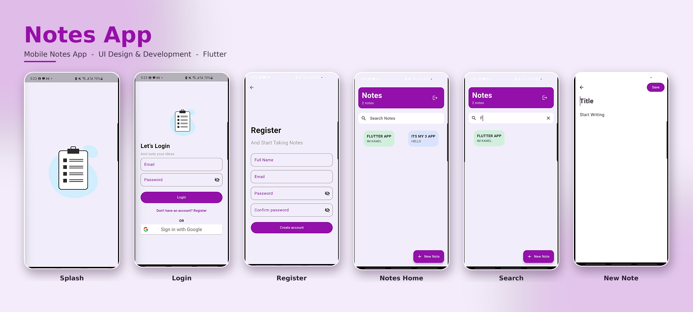

# Notes App

A Flutter notes app with local storage, search, and per-user notes backed by Firebase Authentication.

## Screenshots

## Features
- Create, edit, and delete notes
- Home screen grid view
- Search notes
- Multi-select delete
- Email/password sign-up and login (Firebase Auth)
- Each user sees only their own notes
- Purple UI with a Lottie splash screen

## Tech Stack
- Flutter & Dart
- flutter_bloc (Cubit)
- SQLite (local database)
- Firebase Authentication
- Lottie

## Getting Started
1. Clone the repo:
   ```bash
   git clone https://github.com/KamelAli545/notesapp.git
   ```
2. Install dependencies:
   ```bash
   flutter pub get
   ```
3. Set up Firebase:
   - Create a Firebase project and enable Email/Password sign-in.
   - Add your app with `flutterfire configure` or place `google-services.json` in `android/app/`.
4. Run the app:
   ```bash
   flutter run
   ```

## Roadmap
- [ ] Sync notes to Cloud Firestore

## Author
Kamel Ali Kamel · [LinkedIn](https://linkedin.com/in/kamel-ali03) · [GitHub](https://github.com/KamelAli545)
